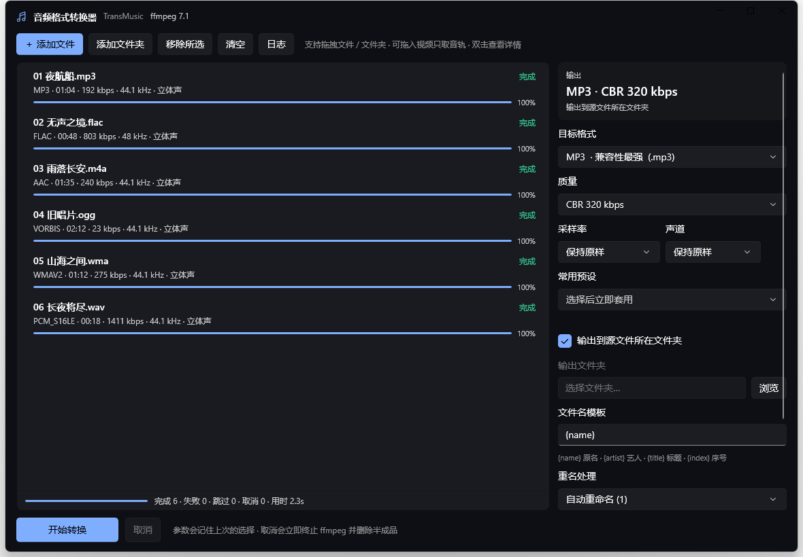

# 音频格式转换器 · TransMusic 1.0.0

**[⬇ 下载页](https://github.com/Lovelifeandyou/TransMusic/releases)**　Windows x64 免安装包 · Android ARM APK · 源码包

**Windows（WinUI 3）+ Android（Material 3 Expressive / Jetpack Compose）** 双端音频格式互转工具，
另附一套 Python 命令行工具作为批量引擎与测试基准。三端共用同一份格式定义，
同一份源文件在任意端都会得到**完全相同的 ffmpeg 编码参数**（354 个用例逐条自动化对齐）。

支持互转：**MP3 · AAC/M4A · ALAC/M4A · FLAC · WAV · AIFF · OGG Vorbis · Opus · WMA · WavPack · TTA · AC3 · E-AC3 · MP2 · Speex**（15 种输出）。
输入只要是 ffmpeg 能解码的都行，**DSD 与视频文件也能直接转**：

- **DSD（.dsf / .dff）**：DSD64 / DSD128 / DSD256 都能读入，自动降到 88.2kHz 系的 PCM
  （DSD64→88.2k、DSD128→176.4k、DSD256→352.8k），并在降采样前加 30kHz 低通抑制超声波噪声混叠。
  > **为什么不能输出 .dsf/.dff**：ffmpeg 只有 DSD **解码器**（dsd_lsbf/msbf），既没有 DSD 编码器，
  > 也没有 dsf/dff 的 muxer —— 实测 fmpeg -c:a dsd_lsbf -f dsf out.dsf 会报
  > Requested output format 'dsf' is not known。所以 DSD 只能作为输入，转出 PCM 格式。
  > 需要 PCM→DSD 得另配 SoX 之类工具链。
  >
  > 另外：Android 系统的 MediaMetadataRetriever 不认识 .dsf/.dff，App 会按扩展名放行交给 ffmpeg 处理
  > （ProbePolicy），DSD64 默认降到 88.2kHz；DSD128/256 建议在设置里手动把采样率选成 176.4k / 352.8k。
  > 内置 3 个配套预设：`DSD → FLAC 归档`、`DSD → WAV 24bit`、`DSD → MP3 320`。
- 视频文件（MP4/MKV/MOV/FLV/WebM…）自动只取音轨。



---

## 一、下载与安装

发布页的 3 个文件：

| 文件 | 适用 | 说明 |
| --- | --- | --- |
| `TransMusic-windows-x64.zip` | Windows 10 1809+ / 11 (x64) | 约 60 MB，解压后双击 `TransMusic.exe`，**免安装**、内置 ffmpeg |
| `TransMusic-android-arm-v1.0.0.apk` | Android 7.0+（arm64-v8a / armeabi-v7a） | 约 28 MB，自签名，需允许「安装未知来源应用」 |
| `TransMusic-src-v1.0.0.zip` | 开发者 | 全部源码（不含构建产物） |

校验：`SHA256SUMS.txt` 里是各文件的 SHA-256。

### Windows

1. 解压 `TransMusic-windows-x64.zip` 到任意目录（路径别用中文层级太深的也行，程序已声明 longPathAware）。
2. 双击 `TransMusic.exe`。
3. 首次启动若 Windows 弹出 SmartScreen 提示，选择「更多信息 → 仍要运行」（未签名应用属正常现象）。

程序自带 `ffmpeg\ffmpeg.exe`、`resources.pri` 与 Windows App SDK 运行时文件，**不需要**另外装 .NET 或 ffmpeg。

### Android

1. 传输 APK 到手机，点击安装；系统提示时允许该来源安装应用。
2. 打开「音频格式转换器」，点右上角「＋」选择音频/视频，或直接拖入。
3. 默认输出到 `Music/TransMusic`（Android 10+ 无需存储权限）；也可在设置里改选任意文件夹。

APK 签名指纹（SHA-256）：

```
CN=TransMusic, OU=Converter, O=TransMusic, L=Beijing, ST=Beijing, C=CN
8F:C4:C9:F7:70:FE:1A:24:BD:59:05:80:FF:3E:E8:CC:4B:47:7D:68:6C:ED:2F:A8:38:D4:15:59:8F:89:B2:C6
```

之后自行重新打包时请复用同一个 keystore（`transmusic-release.jks` 不随源码分发），否则无法覆盖安装。

---

## 二、功能

三端一致：

- 15 种目标格式，质量参数随格式联动（CBR 码率 / VBR 档位 / 无损位深 16-24-32 / 压缩级别）
- 8 个常用预设：MP3 320 通用、MP3 V0 高音质、FLAC 无损归档、FLAC 24bit 母带、CD 级 WAV、AAC 256 手机、Opus 48k 语音、铃声片段参数
- 批量队列 + 并发；单个任务可取消（立即终止 ffmpeg 并删除半成品）
- 默认保留标签与内嵌封面；文件名模板 `{name} {artist} {title} {album} {index} {ext}`、重名策略（重命名 / 覆盖 / 跳过）
- 拖入视频文件只取音轨；**DSD 输入**自动降采样并低通
- 列表**预览专辑封面**；**浅色 / 深色 / 跟随系统**三种外观

平台差异：

| | Windows（WinUI 3） | Android（Compose / MD3E） |
| --- | --- | --- |
| 界面 | 自绘标题栏、任务卡列表（含封面缩略图）、右侧设置侧栏、Fluent 深浅双主题 | 大色块 + 大圆角、Expressive 字体、弹簧动效、BottomSheet 设置、动态取色 |
| 主题 | 跟随系统 / 浅色 / 深色（应用级，切换后自动重启生效） | 跟随系统 / 浅色 / 深色（Compose 运行时切换，即时生效） |
| 封面 | 用 ffmpeg 提取内嵌封面 → 缓存成 png 显示在列表 | 用 MediaMetadataRetriever 取内嵌封面显示在列表 |
| 入口 | 拖放 / 选择文件 / `TransMusic.exe D:\Music` / 发送到 | SAF 文件选择 / 分享打开 |
| 并发 | 1–16 | 1–8 |
| 输出 | 源目录或指定目录 | `Music/TransMusic`（媒体库）或任选文件夹 |
| 附加 | 双击看详情、参数记忆、日志面板 | 长按任务看详情、参数记忆 |

---

## 三、命令行（Python，任意平台）

```bash
pip install mutagen imageio-ffmpeg      # 或自备 ffmpeg 并设置 TRANSMUSIC_FFMPEG

python main.py --list-formats                          # 全部格式与可用参数
python main.py -f flac -o D:\out song.mp3              # 单文件
python main.py -f m4a_aac -b 256 D:\Music              # 整目录递归
python main.py -f mp3 --vbr 0 --template "{artist} - {title}" E:\CD
python main.py -f wav --bit-depth 24 --sr 96000 --ch 2 in.flac
python main.py -f opus -j 4 -n D:\in                   # -n 只打印命令不执行
```

---

## 四、构建

| 平台 | 文档 | 要点 |
| --- | --- | --- |
| Windows | [BUILD-WINDOWS.md](BUILD-WINDOWS.md) | .NET 8 SDK 即可，**不需要 Visual Studio**；`EnableCoreMrtTooling=false` + `EnableMsixTooling=true` 是无 VS 构建的关键 |
| Android | [BUILD-ANDROID.md](BUILD-ANDROID.md) | Android Studio 打开 `android/`（AGP 8.5.2 / Gradle 8.7 / compileSdk 34），依赖可走国内镜像 |

```bash
# Windows
cd windows
dotnet publish TransMusic.App/TransMusic.App.csproj -c Release -r win-x64 --self-contained false

# Android（只打 ARM 架构，体积减半）
cd android
gradle assembleRelease -PabiFilters=arm64-v8a,armeabi-v7a
apksigner sign --ks release.jks --out TransMusic-android-arm.apk app-release-unsigned.apk
```

---

## 五、测试

```bash
python tests/smoke_test.py                # Python 引擎：15 格式矩阵、互转链、标签封面、取消、进度
python tests/parity_winui_test.py         # C# vs Python：354 用例逐参数 diff
cd android && gradle testDebugUnitTest    # Android：354 用例一致性 + 11 项引擎单测（无需模拟器）
python tests/parity_test.py               # 备选：kotlinc 单独跑 Kotlin 对比（需 tools/kotlinc）
python tests/winui_check.py               # WinUI 工程静态检查（XAML/绑定/事件/csproj/格式表漂移）
python tests/android_check.py             # Android 工程静态检查（XML/R 资源/包名/依赖/格式表漂移）
python tests/kotlin_syntax_check.py       # Kotlin 语法级编译

# WinUI 引擎真跑：15 种格式全部转换并回读校验、命名冲突、队列完成/取消
cd windows && dotnet run --project TransMusic.Tests -- selftest --ffmpeg <ffmpeg 路径>
```

当前状态：上述全部通过 —— C# 引擎自检 38/38（含 DSD 实测）、三端参数一致性各 354/354（Windows 用 dotnet、Android 用 Gradle 单测，期望值均由 Python 引擎生成）、Android 引擎单测 11/11。

---

## 六、目录结构

```
transmusic/                 Python 引擎（格式数据源 + CLI + 测试基准）
  formats.py                15 种格式 / 8 预设 / 扩展名表 —— 三端唯一数据源
  engine.py                 ffmpeg 定位、命令构建、探测、执行、进度解析
  cli.py                    命令行批量模式
main.py                     命令行入口

windows/                    Windows 版（WinUI 3）
  TransMusic.Core/          纯 .NET 8 引擎类库
  TransMusic.App/           XAML + MVVM 界面
  TransMusic.Tests/         引擎自检 + 参数对比工具

android/                    Android 版（Kotlin + Compose + MD3E）
  app/src/main/java/com/transmusic/converter/
    model/Formats.kt        ⚠ 自动生成
    engine/  core/  ui/  util/

tools/                      图标生成、三端格式表生成、ffmpeg 获取、截图脚本
tests/                      自动化测试
docs/                       截图
```

---

## 七、常见问题

- **Windows 双击没反应 / 闪退**：确认解压完整（同目录要有 `resources.pri`、`TransMusic.dll`、`ffmpeg\ffmpeg.exe`）。
- **提示找不到 ffmpeg**：放到 exe 同目录、同目录 `ffmpeg\`、PATH，或设环境变量 `TRANSMUSIC_FFMPEG`。
- **转 MP3 报采样率不支持**：程序会把非常规采样率吸附到编码器支持值（96 kHz → 48 kHz），无损格式原样保留。
- **元数据丢了**：目标格式本身不支持标签（WAV / AIFF / AC3 / MP2）时会丢弃，属容器限制。
- **WAV 32 bit 是浮点**（`pcm_f32le`）；要整数 24 bit 请选 24 bit。
- **Android 装不上**：确认是 ARM 设备（x86 平板/模拟器需另打 `x86_64` 架构包：`-PabiFilters=x86_64`）。
- **Android 转码失败**：多为输出目录权限或引擎缺失，先看 App 内「日志」面板的错误行。

## 八、许可与致谢

本项目代码可自由使用与修改。内置或依赖的第三方组件：

- **FFmpeg**（LGPL/GPL，视构建配置）：Windows 版随包附带 ffmpeg 7.1 essentials 二进制；Android 版通过 FFmpegKit 6.0-2 使用
- **FFmpegKit**（LGPL v3）— 已归档项目，本项目通过镜像仓库/离线 AAR 引用
- **Jetpack Compose / Material 3 / Windows App SDK**：Apache 2.0 / MIT
- 编码器（LAME、libopus、libvorbis、libspeex、WavPack 等）各自遵循其许可证

商业分发前请自行复核 FFmpeg 的构建选项（是否含 GPL 组件）与各编解码器的专利/许可要求。
